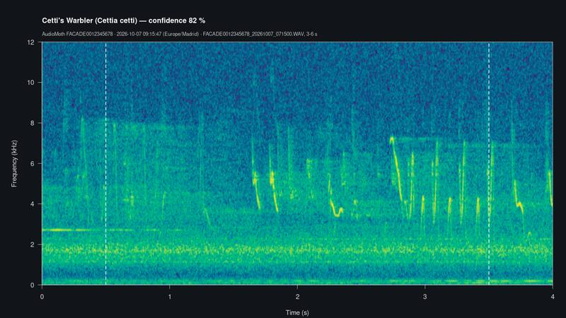
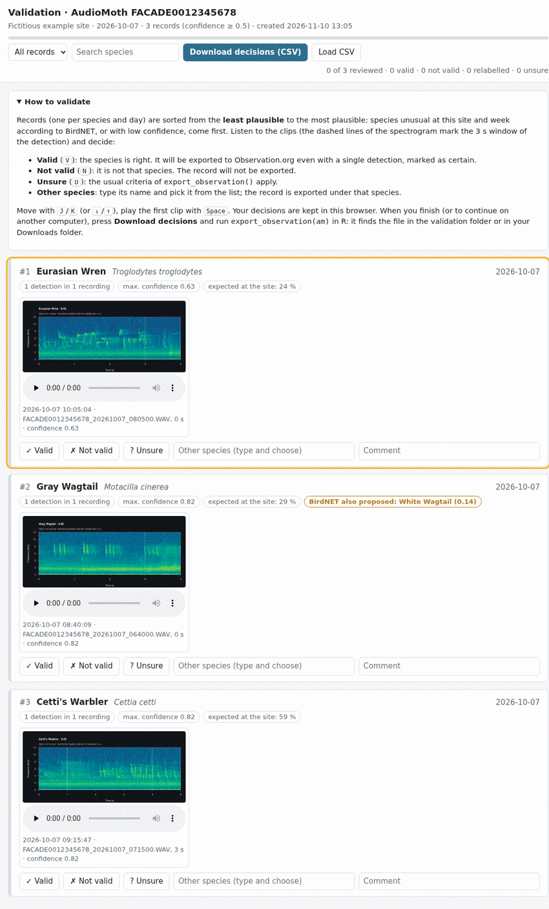
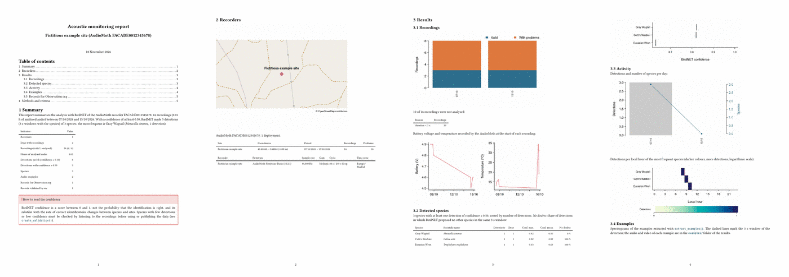

```{r, include = FALSE}
knitr::opts_chunk$set(collapse = TRUE, comment = "#>")
ffmpeg_ok <- !inherits(try(AudiomothR:::ffmpeg_path(), silent = TRUE), "try-error")
# The PDF report is rendered when Quarto is installed, but not during R CMD check
# nor on continuous integration servers (GitHub Actions)
quarto_ok <- !inherits(try(AudiomothR:::quarto_path(), silent = TRUE), "try-error") &&
  rlang::is_installed(c("knitr", "rmarkdown")) && !nzchar(Sys.getenv("_R_CHECK_PACKAGE_NAME_")) &&
  !nzchar(Sys.getenv("CI"))
# The vignette never looks for files in the Downloads folder of this computer
options(AudiomothR.downloads = file.path(tempdir(), "Downloads"))
```

This is the first of three vignettes of **AudiomothR**:

1. **Getting started: the complete workflow** (this one): every step, from
   the SD card of an AudioMoth to the records for Observation.org and the
   PDF report, run with the example card of the package.
2. **Which species BirdNET looks for**: the location filter of BirdNET, own
   lists of species and lists built from GBIF
   (`vignette("audiomothr-2-species")`).
3. **Several cards, several boxes and reports**: a box that stays in the
   field for months, a box that is moved, coming back to the work another
   day, and reports of several boxes (`vignette("audiomothr-3-boxes")`).

You do not need to know much R to follow it: copy each block of code into
the R console (or into a script in RStudio) **in order**, and compare what
you get with what is shown here. Lines that start with `#>` are what R
prints.

## What AudiomothR does

An AudioMoth records thousands of WAV files on its SD card. AudiomothR takes
that card and, step by step:

| Step | Function | Required? | What it produces | Time (real card of 1,700 recordings) |
|---|---|---|---|---|
| 1. Read the card (and copy it to the disk) | `read_audiomoth()` | Yes | Inventory of the recordings, copy of the card | ~2 s (+ the copy) |
| 2. Prepare the audio | `prepare_audio()` | No (step 3 does it) | Audio at 48 kHz mono, when needed | seconds to minutes |
| 3. Analyse with BirdNET | `analyze_birdnet()` | Yes | Table of detections (species, time, confidence) | ~30 min |
| 4. Summarise by species | `species_summary()`, `detected_species()` | No | Table and list of the species | seconds |
| 5. Examples of the species | `extract_examples()` | No | Audio, spectrogram and video of the best detections | ~1 s each |
| 6. Validate by ear | `create_validation()` | No, but recommended | Web page to listen and decide | your time |
| 7. Export to Observation.org | `export_observation()` | Yes, to publish | CSV ready to import | seconds |
| 8. Report | `create_report()` | No | PDF with maps, graphs and tables | ~1 min |

`process_audiomoth()` does all the steps with a single call (see the end of
this vignette), but going through them one by one is the best way to learn
what each one does and to check its results.

### Words used in this vignette

- **Box** (recorder): one AudioMoth, identified by its *device ID* (16
  characters, e.g. `FACADE0012345678`).
- **Card**: the SD card of the box. It holds a `CONFIG.TXT` file and one
  folder per day (`20261007/`) with the WAV files.
- **Deployment**: the period during which a card was in the box at a site.
  A box usually has many deployments (the card is replaced every few days or
  weeks), sometimes at different sites.
- **Results folder** (`output`): the folder where AudiomothR saves
  everything for one box. **One folder per box**, which gathers all its
  cards.
- **Detection**: a 3 s window of audio where BirdNET proposes a species,
  with a **confidence** between 0 and 1. The confidence is a score, not the
  probability that the identification is right.
- **No doubts** (`no_doubts`): BirdNET proposed only one species in that
  window.
- **Probability of occurrence** (`location_prob`): how expected the species
  is at the site in that week of the year, according to the BirdNET
  metadata model (see vignette 2).
- **Record**: one species on one day at one site, which is what
  Observation.org receives.

## 0. Before you start

### Installation

```{r, eval = FALSE}
install.packages("remotes")
remotes::install_github("ajcanepa/AudiomothR")
```

Besides R, AudiomothR needs **ffmpeg**, a program that converts audio and
makes videos:

- Windows: `winget install ffmpeg` in a terminal (PowerShell).
- macOS: `brew install ffmpeg` (with Homebrew).
- Linux: `sudo apt install ffmpeg`.

For the PDF report it also needs **Quarto**, which already comes with
RStudio and Positron (otherwise, <https://quarto.org>). Python does **not**
have to be installed by hand: the birdnetR package installs its own the
first time.

### Check what is installed

```{r}
library(AudiomothR)
check_requirements()
```

Each line is a requirement: `✔` when it is ready and `✖` when it is missing,
with the way to install it. The last line tells the language of the common
names of the species (that of the operating system; it can be changed later
with `language`).

### Install BirdNET (once)

```{r, eval = FALSE}
setup_birdnet()
```

The first time, this installs Python, TensorFlow and the BirdNET model
(about 3 GB, a few minutes, with an Internet connection). It is done once
per computer. When it finishes it prints something like:

```
✔ BirdNET v2.4 is ready (6522 classes; common names in "en_uk").
ℹ Model in '/home/you/.local/share/birdnet/models/v2.4/TFLite'.
```

If it is not run, the first `analyze_birdnet()` does it.

## The example card

The package includes a real AudioMoth card, **reduced and anonymised**: the
device ID (`FACADE0012345678`) and the location (`41.00°N 3.00°W`) are
fictitious; there are two days (7 and 15 October) with 8 recordings each;
most WAV files were cut to 0.05 s and only 6 of them keep about 7 s of real
song. This is where it is and what it contains:

```{r}
example_card <- system.file("extdata", "example", "card", package = "AudiomothR")
list.files(example_card, recursive = TRUE)
```

With a real card, `example_card` would be the path of the card, e.g.
`"E:/"` on Windows, `"/Volumes/AUDIOMOTH"` on macOS or `"/media/you/SD"` on
Linux. It is the folder that contains `CONFIG.TXT`, **not** a daily folder.

### What the box was told to do: `CONFIG.TXT`

`read_config()` reads the configuration file of the card. You do not need
it for the workflow (step 1 reads it), but it is useful to check a card:

```{r}
config <- read_config(file.path(example_card, "CONFIG.TXT"))
config
```

The location of `CONFIG.TXT` (`41, -3 (±698 m)`) only has two decimals,
about 700 m, and it is only right if it was updated in the AudioMoth
Configuration App when the box was placed. That is why the coordinates of
the site should be given in step 1.

### Coordinates: copy and paste them

`parse_coordinates()` reads coordinates in the formats of Google Earth,
Google Maps or a GPS. Step 1 uses it for its `coordinates` argument, so you
can paste them as they come:

```{r}
parse_coordinates("41.123456, -3.123456")             # Google Maps (click on the point)
parse_coordinates("41°07'24.4\"N 3°07'24.4\"W")       # Google Earth, degrees-minutes-seconds
parse_coordinates("N41 07.407 W3 07.407")             # GPS, degrees and decimal minutes
```

`precision_m` is the precision implied by the number of decimals; it is the
`accuracy` that Observation.org receives. Without hemisphere letters the
**latitude goes first**, and west and south are negative.

## 1. Reading the card

```{r}
output <- file.path(tempdir(), "AudiomothR_results", "box_01")

am <- read_audiomoth(
  example_card,
  coordinates = "41.00, -3.00",          # where the box was (fictitious here)
  site = "Fictitious example site",      # optional name of the site
  output = output,                       # results folder of this box
  copy_to = TRUE                         # copy the card to the disk and work on the copy
)
```

What each argument means:

- **`folder`** (the first one): the card. Without it, a window opens to
  choose it (`choose_folder()`).
- **`coordinates`**: where the box was during this deployment.
- **`site`**: a name for the site (it appears in the report).
- **`output`**: the results folder. Here it is a temporary folder that
  disappears when R is closed; **in real use choose a folder of your own,
  outside the card, one per box**, e.g. `"~/AudiomothR_results/box_01"`.
  Without `output`, R asks for it in the console and remembers it for the
  next card of the same box.
- **`copy_to = TRUE`**: before anything else, the card is **copied** into
  `<output>/recordings/`, and from then on everything is done with the
  copy. This is the recommended way: the card can be formatted and taken
  back to the field, and the recordings are kept. `copy_to` may also be a
  folder of a backup disk, e.g. `copy_to = "D:/AudioMoth_backup"`; without
  `copy_to`, the card is read where it is and it must stay connected for
  steps 5 and 6.

The copy keeps the folders and the dates of the files and checks the size of
each one. If it is interrupted, running the same line again copies only what
is missing.

> **Check:** the summary above says *Copy of the card (used from now on)*,
> *Recordings: 16 in 2 days* and *10 with problems: duration < 3 s*. Those
> 10 are the files cut to 0.05 s: in a real card, problems are usually rare
> (empty files at the end of a full card, interrupted recordings...).

### What is inside `am`

`am` is an R object (a list) that collects everything about the box, and
that every step completes:

```{r}
names(am)
am$folder          # the copy of the card, used from now on
am$card_folder     # the original card
```

The **inventory** has one row per WAV file:

```{r}
am$recordings[, c("file", "start_local", "duration_s", "battery_v", "temperature_c", "valid", "problem")]
```

- `start_local`: start of the recording in local time (by default
  `Europe/Madrid`, with daylight saving time; AudioMoth records in UTC, and
  the UTC time is in `start_utc`). Use `time_zone = "Atlantic/Canary"` in
  the Canary Islands.
- `valid` / `problem`: recordings with problems (unreadable, interrupted,
  shorter than 3 s, without date, duplicated) are not analysed.
- Recordings triggered by a threshold (`*T.WAV`) are recognised and their
  silences are restored before the analysis.

The **deployments** of the box (one per card read into this folder):

```{r}
am$deployments[, c("deployment", "site", "lat", "lon", "first_date", "last_date", "recordings")]
```

And this is the results folder so far:

```{r}
list.files(output)
```

`AudioMoth_<ID>_recordings.csv` and `AudioMoth_<ID>_deployments.csv` can be
opened with a spreadsheet. Reading the same card again is fast: the metadata
of the WAV files are kept in a cache.

### Without arguments: the interactive way

In RStudio, the simplest is to run it without arguments and answer:

```{r, eval = FALSE}
am <- read_audiomoth(copy_to = TRUE)
#> (a window opens to choose the card)
#> ℹ Results folder of this box (outside the card; it gathers all the cards of the box).
#>   Press Enter to use '~/AudiomothR_results/AudioMoth_FACADE0012345678', or type another path.
#> Results folder:
#> ! Where was the box during this deployment?
#> ℹ Copy the position of the site in Google Earth (or Google Maps) and paste it here.
#> Coordinates:
```

The folder is suggested with `choose_output()`; the coordinates are asked
for only when they are not in `CONFIG.TXT` (otherwise they are taken from
there, with a warning to check them).

## 2. Preparing the audio for BirdNET

BirdNET listens to audio at 48 kHz in mono. `prepare_audio()` converts what
needs it (e.g. recordings at 250 kHz for bats, or triggered recordings) into
`<output>/audio_48k/`, and leaves out the recordings with problems:

```{r}
am <- prepare_audio(am)
```

Here nothing needs converting: the box recorded at 48 kHz. This step is
optional: `analyze_birdnet()` converts by itself what it needs.

## 3. Analysing with BirdNET

### Path A: with BirdNET installed

```{r, eval = FALSE}
am <- analyze_birdnet(am)
```

This is what it prints with the example card (BirdNET v2.4):

```
BirdNET: 6 recordings; 6 pending.
Loading the BirdNET model...
Location filter: 156 expected species per site and week on average.
✔ 6 detections of 4 species saved in '<output>/AudioMoth_FACADE0012345678_detections.csv'.
```

- Only the 6 valid recordings are analysed.
- **Location filter**: by default BirdNET only looks for the species
  expected at the site and week of each recording (here, about 156). This
  avoids species of other continents, but it may leave out rare species:
  **vignette 2** explains how it works and how to use your own list of
  species instead.
- Each recording is analysed **once**: if the analysis is interrupted (or a
  new card is added), running it again only analyses what is missing.
- The common names are in the language of the system; to change them,
  `analyze_birdnet(am, language = "es")`. Changing the language does not
  analyse the recordings again.

### Path B: without BirdNET (this vignette)

Building this vignette cannot install Python, so here we load the
detections that Path A gave for this card, which are included in the
package. **If you ran Path A, skip this block.**

```{r}
saved <- system.file("extdata", "example", "birdnet_detections.csv", package = "AudiomothR")
am$detections <- read_detections(saved)
# analyze_birdnet() also saves them in the results folder; here we copy the file
file.copy(saved, file.path(output, "AudioMoth_FACADE0012345678_detections.csv"))
```

`read_detections()` also reads the detections saved in a results folder,
e.g. `read_detections("~/AudiomothR_results/box_01/AudioMoth_FACADE0012345678_detections.csv")`.

### The detections

```{r}
am$detections[, c("local_date", "local_time", "start_s", "end_s", "scientific_name",
                  "common_name", "confidence", "no_doubts", "location_prob")]
```

One row per 3 s window and species:

| Column | Meaning |
|---|---|
| `local_date`, `local_time` | When the detection starts (local time) |
| `file`, `start_s`, `end_s` | Recording and seconds of the window (to listen to it) |
| `scientific_name`, `common_name` | Species proposed by BirdNET |
| `confidence` | Score of BirdNET (0-1); detections ≥ 0.10 are kept |
| `no_doubts` | `TRUE` when BirdNET proposed only this species in the window |
| `n_labels_window`, `other_confidence_max` | How many species BirdNET proposed in the window, and the highest confidence of the others |
| `location_prob` | Probability of occurrence at the site and week (0-1) |
| `deployment`, `site`, `lat`, `lon` | Deployment and site of the recording |

> **Check:** 6 detections of 4 species, all on 7 October. In the recording
> of 08:40, BirdNET hesitates in both windows between the grey wagtail
> (*Motacilla cinerea*) and the white wagtail (*Motacilla alba*): their
> `no_doubts` is `FALSE`.

## 4. Summary by species

```{r}
species_summary(am, min_confidence = 0.5)
```

Only detections with a confidence of at least `min_confidence` count (0.5
by default): the white wagtail, with 0.14 and 0.12, does not appear. For
each species: number of detections, days and recordings, highest and mean
confidence, probability of occurrence, and `example_candidates`, the
detections good enough for an example (confidence ≥ `example_confidence`,
0.85 by default, and no doubts). Here no detection reaches 0.85, so there
are no candidates.

`detected_species()` prints the species **as R code**, ready to choose the
examples of step 5. Here the threshold of the examples is lowered to 0.5,
because the example card has few detections:

```{r}
species <- detected_species(am, example_confidence = 0.5)
```

Each number is how many examples of that species can be extracted. There
are two ways of using it:

- **As it is**: `species` already holds the vector, so it can go directly
  to step 5.
- **Edited**: copy the printed lines into your script, change the numbers
  (0 = no examples) or delete species, and run them:

```{r}
species <- c(
  "Cettia cetti"            = 1,   # Cetti's warbler
  "Troglodytes troglodytes" = 1    # Eurasian wren
)
```

## 5. Examples: audio, spectrogram and video

First, without creating any file, see which detections would be used:

```{r}
select_examples(am, species, min_confidence = 0.5)[, c("scientific_name", "local_time", "file", "start_s", "confidence")]
```

`select_examples()` takes the detections with the highest confidence, with
no doubts and at most one per recording (`min_confidence`, `no_doubts` and
`one_per_recording` change that). `extract_examples()` uses the same
choice and creates the files:

```{r, eval = ffmpeg_ok}
examples <- extract_examples(am, species, min_confidence = 0.5, margin_s = 0.5)
basename(c(examples$wav, examples$png, examples$mp4))
```

```{r, eval = !ffmpeg_ok, echo = FALSE, results = "asis"}
cat("_(This block was not run when building the vignette: ffmpeg was not found on this computer.)_\n")
```

For each example, in `<output>/examples/<species>/`:

- a **WAV** clip with the detection and `margin_s` seconds before and after
  (1 s by default);
- its **spectrogram** (PNG), with the 3 s window of BirdNET between dashed
  lines;
- a **video** (MP4) of the spectrogram with the sound, valid for any player
  or social network. `style = "scroll"` makes the spectrogram scroll under a
  fixed line instead of a moving cursor; `video = FALSE` skips the videos.

This is the spectrogram of the Cetti's warbler:

```{r, echo = FALSE, out.width = "100%", fig.alt = "Spectrogram of the Cetti's warbler example"}

```

The same drawings can be made of **any WAV file**, e.g. one of the copy of
the card, with `spectrogram_image()` (it only needs R) and
`spectrogram_video()` (it needs ffmpeg):

```{r}
wav <- am$recordings$path[am$recordings$valid][1]
png <- spectrogram_image(wav, file.path(tempdir(), "my_spectrogram.png"),
                         title = "My first spectrogram", max_freq = 10000)
file.exists(png)
```

```{r, eval = FALSE}
spectrogram_video(wav, file.path(tempdir(), "my_video.mp4"), style = "scroll")
```

## 6. Validating the records by ear (optional, recommended)

BirdNET makes mistakes, above all with species that are rare at the site or
detected with low confidence. Before publishing, the records can be checked
by ear on a web page:

```{r}
page <- create_validation(am, min_confidence = 0.5, open = FALSE)
```

With `open = TRUE` (the default in RStudio) the page opens in the browser.
It is in `<output>/validation/AudioMoth_<ID>_validation.html`, works
**offline and without R** (the whole `validation/` folder can be sent to an
expert) and looks like this:

```{r, echo = FALSE, out.width = "100%", fig.alt = "Validation page with three records"}

```

- There is **one card per record** (species and day), sorted from the
  **least plausible** (low confidence and low probability of occurrence) to
  the most plausible, so the doubtful ones come first.
- Each card shows the number of detections, the highest confidence, how
  expected the species is at the site, the other species that BirdNET
  proposed in the same windows (in orange), and the clips (`n_clips`, 2 by
  default) of the best detections with their spectrograms.
- For each record, decide:

| Button | Key | Meaning | Effect on the export (step 7) |
|---|---|---|---|
| **Valid** | `V` | The species is right | Exported, marked as certain, even with one detection |
| **Not valid** | `N` | It is not that species | Not exported |
| **Unsure** | `U` | Cannot tell | The usual criteria apply |
| **Other species** | (type) | It is another species | Exported under the new species, as certain |

`J` and `K` move between cards and `Space` plays the first clip. The
decisions are kept in the browser while you work. **When you finish, press
*Download decisions (CSV)*:** the browser saves
`AudioMoth_<ID>_validation.csv` in your *Downloads* folder, where step 7
finds it (another folder can be set with `options(AudiomothR.downloads =
"path")`). *Load CSV* reloads decisions saved before, e.g. to go on another
day or on another computer.

The same CSV is also in the `validation/` folder and can be filled in with a
spreadsheet instead of the page (columns `decision`: `valid`, `invalid` or
`unsure`; `new_name`: scientific name of the right species). Here we do
that, with three decisions:

```{r}
file <- file.path(output, "validation", "AudioMoth_FACADE0012345678_validation.csv")
decisions <- read.csv(file)
decisions[, c("record_id", "scientific_name", "common_name", "detections", "confidence_max")]

decisions$decision[decisions$scientific_name == "Troglodytes troglodytes"] <- "valid"
decisions$decision[decisions$scientific_name == "Cettia cetti"] <- "unsure"
decisions$new_name[decisions$scientific_name == "Motacilla cinerea"] <- "Motacilla alba"
write.csv(decisions, file, row.names = FALSE, na = "")
```

`read_validation()` shows the decisions that will be applied (and tells you
which file it found):

```{r}
read_validation(am)[, c("date", "scientific_name", "decision", "new_name")]
```

Running `create_validation()` again later (e.g. after adding a card) keeps
the decisions already taken.

## 7. Exporting to Observation.org

```{r}
obs <- export_observation(am)
obs[, c("date", "time", "scientific name", "is certain", "notes")]
```

By default a record (species and day) is exported when it has **at least 2
detections with a confidence ≥ 0.80** that day, **plus** the records
validated by ear. No species of this small card meets the criteria, so only
the validated ones are exported: the wren (valid) and the wagtail under its
new name, the white wagtail; the Cetti's warbler (unsure) follows the
criteria and is left out.

The criteria can be changed, e.g. for this card:

```{r}
obs <- export_observation(am, min_confidence = 0.5, min_detections = 1, validation = FALSE,
                          overwrite = TRUE)
obs[, c("date", "time", "scientific name", "is certain")]
```

| Argument | Meaning |
|---|---|
| `min_confidence`, `min_detections` | Criteria of a record (0.80 and 2) |
| `no_doubts_only = TRUE` | Count only the detections without doubts |
| `species`, `from`, `to` | Only some species or dates (e.g. `species = "Cettia cetti"`, `from = "2026-10-01"`) |
| `validation = FALSE` | Ignore the validation |
| `validated_only = TRUE` | Export only the records validated as correct |
| `is_certain` | `"auto"` (validated = `True`, the rest `False`), `"True"` or `"False"` |
| `equivalences` | Own translations of names, `c("BirdNET name" = "Observation.org name")` |
| `overwrite = TRUE` | Replace an export that was edited by hand |

The CSV (`<output>/AudioMoth_<ID>_observation.csv`) has the 19 columns of the
import format of Observation.org:

- `date`, `time`: local date and time of the first detection of the day.
- `scientific name`: the name of the species **in Observation.org**. BirdNET
  uses the eBird/Clements taxonomy, so its names are translated through the
  IOC World Bird List into the species list of Observation.org (e.g.
  *Corvus cornix* → *Corvus corone*). Classes that are not birds (human
  voice, noise, frogs, insects) are left out.
- `lat`, `lng`, `accuracy`: the location of the deployment and its precision.
- `notes`: "Identified with BirdNET v2.4", whether it was validated by ear,
  and the best detection (file, second and confidence), so the audio can be
  found again.
- `is certain`: `True` only for the records validated by ear.
- `method` / `counting method`: `Oído` / `Sin especificar`.
- `external reference`: a unique code of the record, so the same record is
  not imported twice.

**Uploading it:** in Observation.org, use the import of observations from a
file (the one that offers the example file `observations-import-example.xlsx`),
choose the CSV and **check the preview** before confirming. If you edit the
CSV by hand (e.g. with a spreadsheet, keeping it comma separated), a new
export does not overwrite it: it is saved with the date in its name, unless
`overwrite = TRUE`.

## 8. PDF report (optional)

```{r, eval = quarto_ok, results = "hide", message = FALSE}
pdf <- create_report(am, open = FALSE)
```

```{r, eval = quarto_ok}
basename(pdf)
```

```{r, eval = !quarto_ok, echo = FALSE, results = "asis"}
cat("_(This block was not run when building the vignette: Quarto was not found on this computer.)_\n")
```

`create_report()` writes the report in `<output>/report/` (with `open =
TRUE`, the default in RStudio, it opens the PDF). It has a summary, a map of
the sites (on OpenStreetMap when the packages `maptiles`, `sf` and `terra`
are installed and there is Internet; otherwise only the points), the state
of the recordings (by day, problems, battery and temperature), the detected
species with their confidence, the activity by day and by hour, the
spectrograms of the examples, the records for Observation.org, the result of
the validation and the methods. These are its first pages for the example
card:

```{r, echo = FALSE, out.width = "100%", fig.alt = "First four pages of the PDF report"}

```

The folder `report/` can be edited (`report.qmd`) and rendered again; the
report of several boxes is in vignette 3.

## Everything in one call: `process_audiomoth()`

Once you know the steps, a card can be processed with a single call (it
needs BirdNET, so it is not run here):

```{r, eval = FALSE}
am <- process_audiomoth(
  folder = "E:/",                                # the card (without it, a window opens)
  coordinates = "41.123456, -3.123456",          # where the box was
  site = "River - bridge",
  output = "~/AudiomothR_results/box_01",        # results folder of the box
  copy_to = TRUE,                                # copy the card and work on the copy
  example_species = "auto",                      # examples of the species of detected_species()
  example_confidence = 0.85,
  validation = TRUE,                             # validation page
  report = TRUE,                                 # PDF report
  language = "en_uk"                             # arguments of analyze_birdnet() can be added
)
```

It runs steps 1, 2, 3, 7, 5, 6 and 8 in that order. Observation.org is
exported with the default criteria only the first time; **after validating
the records by ear, run `export_observation(am)` again** so that the
decisions are applied. If it is interrupted, running it again goes on where
it stopped.

## Where everything is

```{r}
files <- list.files(output, recursive = TRUE)
files[!grepl("^(birdnet|recordings|validation/clips|report/)", files)]
```

| File or folder | Contents |
|---|---|
| `AudioMoth_<ID>_deployments.csv` | The cards (deployments) of the box: dates, site, location |
| `AudioMoth_<ID>_recordings.csv` | Inventory of all the recordings |
| `AudioMoth_<ID>_detections.csv` | All the detections of BirdNET |
| `AudioMoth_<ID>_observation.csv` / `.json` | The import file for Observation.org and its criteria |
| `recordings/` | The copies of the cards (with `copy_to = TRUE`) |
| `examples/` | Clips, spectrograms and videos of the examples |
| `validation/` | Validation page, clips and decisions |
| `report/` | The PDF report and its Quarto folder |
| `birdnet/` | Results of BirdNET per recording (do not delete it: it avoids analysing again) |
| `audio_48k/` | Converted audio, when needed (can be deleted after the analysis) |

## If something goes wrong

| Message or problem | What to do |
|---|---|
| `Cannot find ffmpeg` | Install ffmpeg (see *Before you start*) or tell R where it is: `options(AudiomothR.ffmpeg = "C:/ffmpeg/bin/ffmpeg.exe")` |
| `There is no CONFIG.TXT` | You chose a daily folder: choose the folder of the card that contains `CONFIG.TXT` |
| `Cannot write in ...` | The card is write-protected or the folder is read-only: give another `output` |
| `Give the results folder with output` | In scripts run with `Rscript`, `output` must be given |
| `The coordinates are ... km away from the location of the CONFIG.TXT` | Check the coordinates (latitude first; west negative), or ignore it if the box was moved without updating `CONFIG.TXT` |
| The first `analyze_birdnet()` takes long | Normal: it installs Python and BirdNET once (run `setup_birdnet()` beforehand) |
| Species of other continents | Check the coordinates; do not use `location_filter = FALSE` without validating by ear |
| A species you know is there never appears | The location filter may leave it out: see vignette 2 |
| `0 of the 3 requested examples meet the criteria` | Lower `min_confidence` of `extract_examples()`, or use `no_doubts = FALSE` |
| Examples or validation without audio | Without `copy_to`, the card must be connected at the same path |
| Too many messages | `options(AudiomothR.quiet = TRUE)` hides the informative ones |

## Next steps

- **Vignette 2**, `vignette("audiomothr-2-species")`: why a species may be
  missing, own lists of species (also those of BirdNET-Analyzer) and lists
  from GBIF.
- **Vignette 3**, `vignette("audiomothr-3-boxes")`: the next cards of the
  same box, a box that is moved, coming back another day and reports of
  several boxes.
- The help of each function: `?read_audiomoth`, `?analyze_birdnet`,
  `?export_observation`...

## How to cite

If you use AudiomothR, cite the version you used, and also BirdNET and,
when you use them, the IOC World Bird List and GBIF:

```{r}
citation("AudiomothR")
```

## References

- Gill F, Donsker D, Rasmussen P (Eds) (2026). *IOC World Bird List*
  (v15.2). <https://www.worldbirdnames.org>
- Hill AP, Prince P, Piña Covarrubias E, Doncaster CP, Snaddon JL, Rogers A
  (2018). AudioMoth: Evaluation of a smart open acoustic device for
  monitoring biodiversity and the environment. *Methods in Ecology and
  Evolution* 9(5): 1199-1211. <https://doi.org/10.1111/2041-210X.12955>
- Kahl S, BirdNET Team (2025). *birdnetR: Deep Learning for Automated
  (Bird) Sound Identification*. R package version 0.3.2.
  <https://doi.org/10.32614/CRAN.package.birdnetR>
- Kahl S, Wood CM, Eibl M, Klinck H (2021). BirdNET: A deep learning
  solution for avian diversity monitoring. *Ecological Informatics* 61:
  101236. <https://doi.org/10.1016/j.ecoinf.2021.101236>

## Session information

The versions of R and of the packages with which this vignette was built:

```{r}
sessionInfo()
```
